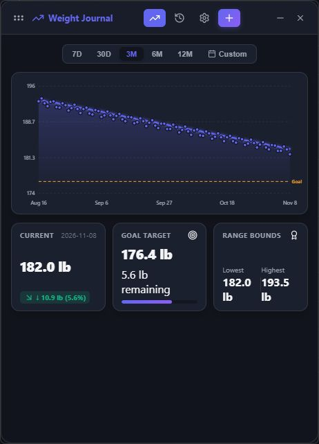
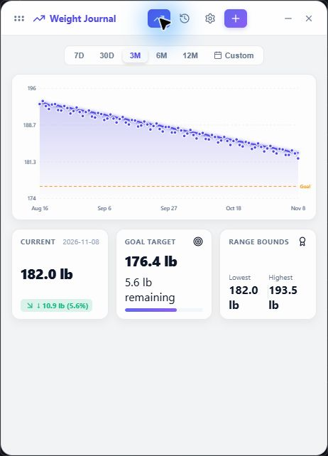
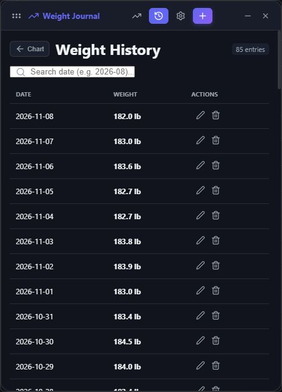
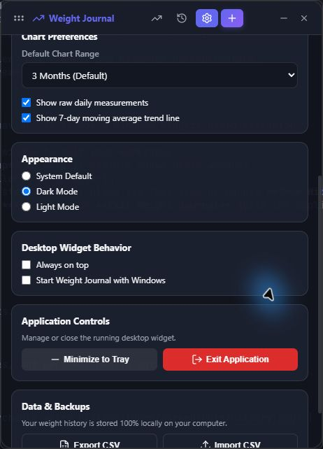

# Weight Journal

A private desktop journal for your weight, with a chart you can keep beside your everyday work.

Built with **Tauri 2, Rust, React, TypeScript, and SQLite**. Record a measurement, follow the trend, and keep your data on your own computer. No account or cloud service is required for core features.



## Features

- **Daily journal:** add, edit, and delete dated measurements, with one entry per date and duplicate replacement confirmation.
- **Trends at a glance:** daily measurements, a 7-day moving average, hover details, and an optional goal reference line.
- **Flexible ranges:** 7 days, 30 days, 3 months, 6 months, 12 months, or a custom date range.
- **Progress summaries:** latest weight in the selected range, change from your first entry or period start, goal progress, and range lows/highs.
- **Your preferred units:** pounds or kilograms; weights are stored canonically in kilograms.
- **Searchable history:** find dates and edit entries from the history view.
- **Desktop controls:** a borderless, draggable, resizable window, optional always-on-top behavior, system tray menu, and start with Windows.
- **Light, dark, or system appearance.**
- **Portable data:** CSV import with validation and duplicate preview, CSV export, and database backup/restore.
- **First-run setup:** choose units and record your starting measurement and goal.

## A journal that works as a widget

Weight Journal is a small desktop application with widget-style behavior. It is not a Windows Widgets-board extension.

1. Drag the grip or header to place it on your desktop. Resize the window to suit your workspace.
2. In **Settings → Desktop Widget Behavior**, enable **Always on top** to keep it visible above other windows.
3. Enable **Start Weight Journal with Windows** if you want it available after sign-in.
4. Use the **minus** button to hide it in the system tray. The app stays running; click its tray icon or choose **Show Widget** to bring it back.
5. The tray menu also opens Add Weight, History, and Settings. The **X** button or **Exit Weight Journal** quits the application.

| Shortcut | Action |
| --- | --- |
| `Ctrl+N` | Add a measurement |
| `Ctrl+H` | Open history |
| `Ctrl+,` | Open settings |

Window position and size are not currently persisted across restarts.

## Screenshots

These are captures of the application using synthetic sample entries, not personal health data.

| Light appearance | Entry history |
| --- | --- |
|  |  |

<details>
<summary>Widget settings and desktop controls</summary>



</details>

## Lightweight by design

Tauri uses the operating system's webview with a Rust backend. Unlike Electron, it does not bundle a separate Chromium and Node.js runtime with each app. On Windows, the interface runs in Microsoft Edge WebView2. See [Tauri's webview architecture](https://v2.tauri.app/reference/webview-versions/).

This architecture keeps the application package lean and makes Tauri a useful fit for an unobtrusive desktop journal. **Actual memory consumption depends on the OS, webview processes, data, and workload.** This project does not yet publish a measured RAM figure or a like-for-like Electron benchmark, so lower RAM use is a design goal rather than a verified comparison.

To measure it, use a release build, let it settle with a known number of entries, and record both the app process and its associated WebView2 processes in Task Manager. Report the OS, app version, dataset size, visible/tray state, and metric used; the Rust process alone understates total memory use.

## Platform status

**Windows is the current build target.** Windows release compilation and installer generation have been verified. macOS and Linux have not been built or tested for this project; the Tauri foundation is portable, but transparency, tray behavior, launch at login, and packaging still need platform-specific verification. Mobile platforms are not configured.

## Run the application

If you have a Windows installer built from this repository, run the `.exe` setup or `.msi`, then open **Weight Journal**. Prebuilt GitHub releases are not set up yet.

After building locally, you can also run:

```powershell
.\src-tauri\target\release\weight-journal.exe
```

The release executable includes the frontend and does not need Vite or an internet connection for journaling. Windows needs the WebView2 runtime; the generated installer handles its runtime installation when needed.

## Develop locally

Install:

- Node.js **22.12+** and npm (a supported Node LTS release is recommended).
- The stable Rust toolchain through [rustup](https://rustup.rs/).
- On Windows: Microsoft C++ Build Tools with **Desktop development with C++**, the Windows SDK, and Microsoft Edge WebView2.
- Git, to clone the repository.

Follow the official [Tauri prerequisites](https://v2.tauri.app/start/prerequisites/) for your OS. macOS/Linux setup instructions there do not imply this app has been validated on those platforms.

From the repository root:

```sh
npm ci
npm run tauri dev
```

Tauri starts Vite at `http://localhost:1420` and opens the desktop application. Frontend edits reload through Vite; Rust edits rebuild the native app. The first Rust build can take several minutes.

`npm run dev` starts only the frontend server. The interface uses native Tauri commands for storage and window controls, so a plain browser is not a fully functional version of the application.

### Keep development data separate

By default, development and release builds use the same journal. To use an isolated journal in PowerShell:

```powershell
$env:WEIGHT_JOURNAL_DATA_DIR = Join-Path $PWD '.local/dev-data'
npm run tauri dev
Remove-Item Env:WEIGHT_JOURNAL_DATA_DIR
```

The override selects the directory containing `weight.db`. Use an absolute path. The `.local` directory and database files are ignored by Git.

## Check and test

```sh
# Type-check TypeScript and build the production frontend
npm run build

# Run the existing Rust model serialization tests
cargo test --locked --manifest-path src-tauri/Cargo.toml
```

The automated tests currently cover serialization, not end-to-end behavior. Before releasing, manually check first-run setup, adding/editing/deleting a measurement, unit switching, date ranges, themes, CSV duplicate handling, backup/restore, dragging/resizing, always-on-top, tray hide/show, and launch at login. Use an isolated journal when testing imports and restores.

## Build a release

```sh
npm ci
npm run tauri build
```

Tauri runs the frontend production build, compiles the optimized native executable, and creates installers. On Windows, outputs are:

```text
src-tauri/target/release/weight-journal.exe
src-tauri/target/release/bundle/nsis/*-setup.exe
src-tauri/target/release/bundle/msi/*.msi
```

For just the executable without installers:

```sh
npm run tauri build -- --no-bundle
```

Build installers on the target operating system. Packaging may download installer tooling and runtime prerequisites. See [Tauri's Windows installer documentation](https://v2.tauri.app/distribute/windows-installer/). Signing and automated GitHub releases are not configured.

### Troubleshooting

- **“Can't reach this page” in the desktop app:** a debug executable expects Vite to be running. Use `npm run tauri dev`, or run the release executable for standalone use.
- **Port 1420 is busy:** stop the other Vite process before starting Tauri; the development port is fixed.
- **Rust linker/build-tool errors:** verify the C++ workload and Windows SDK, then reopen your terminal.
- **Empty or missing journal after moving machines:** restore a database backup or import a CSV through Settings; data is local and does not sync automatically.

## Data and privacy

On Windows the default database is `%APPDATA%\WeightWidget\weight.db`.

The SQLite database and exported files are **not encrypted**. Back them up and protect them as personal data. CSV files use a header followed by date and weight columns; use `YYYY-MM-DD` dates and select the matching unit when importing. Database restore replaces the current journal, so export a backup first.

## Project layout

```text
src/                      React views, chart, styles, and Tauri API wrappers
src-tauri/src/            Rust commands, SQLite storage, and model tests
src-tauri/tauri.conf.json  Window and packaging configuration
docs/screenshots/         Showcase images using synthetic data
scripts/                  Reproducible sample-data helper
```

